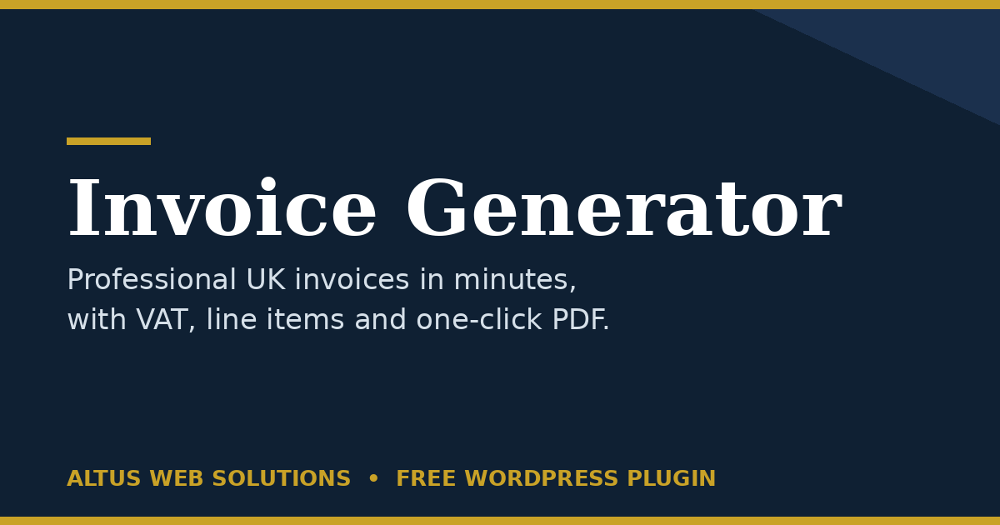

# Altus Invoice Generator — Free WordPress Plugin

**A free UK invoice generator for WordPress: build a professional invoice in minutes — your logo, VAT number, line items with automatic totals, invoice numbering, issue and due dates — then download or print it as a PDF. No account, no sign-up.**

> **⬇️ Download now:** get the latest release zip from the [**Releases page**](../../releases) → WordPress → Plugins → Add New → Upload Plugin → Install Now → Activate → add the shortcode `[altus_invoice_generator]` to any page.

**Keywords people search for:** free invoice generator uk, invoice generator for freelancers, invoice template uk, vat invoice generator, small business invoice maker, pdf invoice generator, invoice generator for trades, freelance invoice template, how to invoice as a freelancer uk, free invoice maker no sign up.

## What it does

If you're a freelancer, contractor or tradesperson, invoicing is the boring bit between doing the work and getting paid. Word templates go stale, spreadsheets break, and half-finished invoices sit in your drafts while your cash flow waits.

This generator fixes that. Fill in your details once, add your line items, and watch a clean, professional invoice build itself live on screen — subtotal, flat discount and VAT/tax calculated automatically — then download or print it as a PDF straight from your browser. No account, no sign-up, nothing to install. Everything runs in your browser: your business details, client names and amounts never leave your computer.

## Who it is for

- **Freelancers and sole traders** — designers, writers, developers, consultants, photographers — who need a proper invoice for every job without paying for accounting software.
- **Tradespeople** — plumbers, electricians, builders, painters, gardeners — whose invoice is often the last thing between the finished job and getting paid.
- **Small businesses** that send a handful of invoices a month and want them to look professional — logo, VAT number, clear totals — without a monthly subscription.
- **Anyone still invoicing in Word** and losing an afternoon to formatting every time.

## The problem it solves

The invoice is the last thing between you and getting paid, and a vague one buys you "just checking this" emails and delays. A proper UK invoice needs a few essentials — a unique invoice number, your business name and address, your client's name and address, a clear description of the goods or services, the supply date, the invoice date, the amount being charged, and VAT details plus your VAT number if you're VAT-registered. Miss these and you risk payment delays — or questions from HMRC at the wrong moment.

This plugin puts all of them on the page for you, in the right places, with the maths done for you. Keep your numbering sequential and unique (INV-0001, INV-0002…), state your payment terms on every invoice — most freelancers use 14 or 30 days — and send the invoice the same day the work finishes. If a client pays late, UK law gives you the right to charge statutory interest, so agreed terms are worth setting in writing from the first invoice.

## Features — and why each one matters

### A professional invoice, not a spreadsheet printout

- **Your business name, logo, email, address and VAT number on the invoice.** Why it matters: a professional invoice with your logo and VAT number says "this business has its act together" — and businesses like that get paid faster. The logo is read in your browser only; it is never uploaded to the server.
- **A live invoice preview that builds itself as you type.** Why it matters: you see exactly what the client will see, before you send it. No surprises in the PDF, no re-typing after printing.
- **Invoice numbering, issue and due dates, a description and a notes field for payment terms or bank details.** Why it matters: numbering discipline is what stops the "which invoice was that?" confusion, and written payment terms are what you rely on when a client pays late.

### Maths you don't have to check twice

- **Line items with quantity and rate; automatic subtotals.** Why it matters: add a row, type a quantity and a rate, and the line total appears. No calculator, no transcription errors, no "£340 or £430?" moment.
- **Flat discounts and VAT/tax at any rate — (subtotal − discount) × tax%.** Why it matters: most jobs aren't just "hours × rate". A discount for a returning client, 20% VAT on top, or a different rate for a different country — the tool applies the order properly: discount first, then tax on what's left.
- **The tax base is clamped at zero, so a discount bigger than the subtotal can never produce a negative total.** Why it matters: a negative invoice total is nonsense, and it's the kind of edge case that only shows up on a real invoice at the worst moment. The tool can't produce one.
- **2-decimal rounding with en-GB money grouping (£1,234.50).** Why it matters: money on an invoice has to look right. £1,234.50, not £1234.5 or £1234.499999 — the rounding hides the floating-point wobble so your client never sees it.

### Built for UK freelancers — and beyond

- **Nine currencies: GBP £, USD $, EUR €, AED, SAR, PKR Rs, INR ₹, CAD C$ and AUD A$.** Why it matters: switch the currency and the invoice works the same way, so the same tool covers a UK client on Monday and an overseas client on Tuesday. Just make sure the tax and legal details match the country you're invoicing in.
- **Download or print as PDF in one click (uses your browser's print-to-PDF).** Why it matters: click "Download / Print PDF", choose "Save as PDF" in the print dialog, and you have a file to email. The print stylesheet shows only the invoice itself — none of the form, none of the buttons. It works in Chrome, Edge, Firefox and Safari.

### Private by design

- **100% client-side: no server endpoint, no database table, no file written on the server, no third-party libraries.** Why it matters: your business details, client names and amounts never leave your computer. There is no server to leak them, no account to create, and no email form standing between you and your invoice.
- **No email gate in this version.** Why it matters: the result is on the screen immediately — a finished invoice you can print — with no name and email address required.

## How it works

1. Add the shortcode `[altus_invoice_generator]` to a page.
2. A visitor adds their business details — name, email, address, and VAT number if VAT-registered. They can upload their logo for a branded look.
3. They add their client — name, email and address.
4. They set the invoice details — a unique invoice number, a short description, issue date and due date.
5. They add line items — description, quantity and rate for each. The subtotal, discount and VAT are calculated automatically, and the live preview updates as they type.
6. They hit **Download / Print PDF**, choose "Save as PDF" in the print dialog, and send it to their client.

Everything happens in the browser. No account, no email address, no data sent anywhere.

## Installation (2 minutes, from the release zip)

1. Download the latest `altus-invoice-generator-v1.0.1.zip` from the [**Releases page**](../../releases).
2. In WordPress, go to **Plugins → Add New → Upload Plugin**, choose the zip, click **Install Now**, then **Activate**.
3. Create or edit a page and add the shortcode: `[altus_invoice_generator]`
4. Publish the page. Done — visitors can build invoices from it.

## Frequently asked questions

**Is this invoice generator really free?**
Yes — completely free, no account, no limits, no watermark.

**How do I save the invoice as a PDF?**
Click "Download / Print PDF", then choose "Save as PDF" (or "Microsoft Print to PDF") as the printer in the dialog that appears. It works in Chrome, Edge, Firefox and Safari. The print stylesheet shows only the invoice itself.

**Can I add VAT to my invoice?**
Yes. Set any VAT/tax percentage, and add your VAT number in the business details — it appears on the invoice automatically.

**What should a UK invoice include?**
A unique invoice number, your business name and address, your client's name and address, a clear description of the goods or services, the supply date, the invoice date, the amount charged, and VAT details plus your VAT number if you are VAT-registered. Keep numbering sequential and unique (INV-0001, INV-0002…) and state your payment terms on every invoice — most freelancers use 14 or 30 days.

**Can I use it for clients outside the UK?**
Yes — switch the currency and the invoice works the same way. Just make sure the tax and legal details match the country you are invoicing in.

**Does anything I enter leave my computer?**
No. The invoice is built entirely in your browser. In this open-source version there is no email option at all — nothing you enter is sent anywhere, stored anywhere, or seen by anyone.

**Is the invoice legally valid?**
The tool builds the document for you; it is not tax or legal advice. If you are unsure about VAT registration or what your invoices must show, check GOV.UK or speak to your accountant.

## Honest limits

- **Invoices produced by this tool are drafts/templates only — NOT legal, tax or financial advice.** Check the tax and legal details (VAT registration, what an invoice must show, payment terms) before sending an invoice to a client, and have them reviewed by an accountant or other professional where it matters.
- **No saved invoices.** This open-source version stores nothing, so an invoice you like should be downloaded or printed before you leave the page — there is no account to save it to, and refreshing the page starts a blank invoice.
- **Browser print-to-PDF, not a server PDF.** The PDF comes from your browser's print dialog, so the exact look depends on your browser and its print settings. Check the print preview before saving, especially the first time.
- **One invoice at a time.** The tool builds a single invoice per page visit — it is not an accounting system. It doesn't track who has paid, send reminders, or keep a running total of your income.
- **UK conventions by default.** The layout, money formatting and invoice essentials follow UK practice. The tool works for other countries if you switch the currency and check the local rules yourself.

## Changelog

### 1.0.1

First public release (stripped open-source version). Professional UK invoice builder: business details with logo upload and VAT number, client details, invoice numbering, issue/due dates, line items with quantity and rate, automatic subtotals with flat discount and VAT/tax at any rate, live invoice preview, one-click download/print as PDF, 9 currencies (GBP, USD, EUR, AED, SAR, PKR, INR, CAD, AUD), payment-terms notes. Email delivery, lead storage and email sending removed — the full result is shown on screen instead. The invoice logic passed a 49-test Node harness (core totals, VAT, discount, currency formatting and text-summary checks; the harness's email/lead assertions are removed along with that feature). One Plugin Check finding fixed in this version: the original inlined its stylesheet by echoing the CSS file contents, which Plugin Check flags as unescaped output — the stylesheet is now enqueued with `wp_enqueue_style`, the standard WordPress way.

## What data does this tool handle?

This GitHub version contains NO lead capture, NO email sending, and NO data storage — results are shown on screen only. The version hosted on altuswebsolutions.com may offer email delivery; this open-source version does not. Nothing the visitor enters — business details, client names, amounts — leaves their browser: there is no server endpoint in this version, no database table is created, no file is written on the server, and nothing is transmitted to any external service. Invoices are built in the browser and printed or saved directly from the page.

## Disclaimer

This software is provided free of charge, "as is", WITHOUT warranty of any kind, express or implied, including but not limited to the warranties of merchantability and fitness for a particular purpose. The authors are NOT liable for any loss, damage or cost arising from the use of this software, including but not limited to incorrect invoice amounts, missed VAT details, or time spent installing it. Always back up your WordPress site before installing any plugin, and test new plugins on a staging site where possible. Invoices produced by this tool are drafts/templates only — NOT legal, tax or financial advice. Check the tax and legal details before sending an invoice to a client, and have them reviewed by an accountant or other professional where it matters.

## Licence

GPLv2 or later. See [LICENSE](LICENSE).
